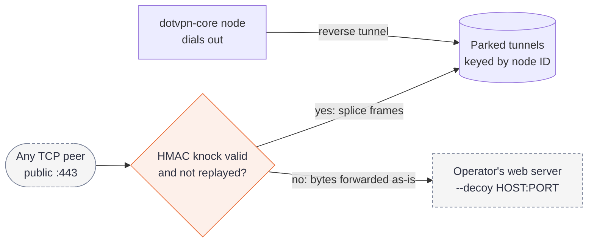

# dotvpn-relay

[](https://github.com/payam-foundation/dotvpn-relay/actions/workflows/ci.yml)
[](https://github.com/payam-foundation/dotvpn-relay/releases)
[](#status)
[](LICENSE)

The in-country stealth hop of [dotvpn](https://github.com/payam-foundation/dotvpn-wire#related-repositories). A relay looks like an ordinary HTTPS website to anyone who is not a dotvpn client, and splices clients onto tunnels that a `dotvpn-core` node has parked on it.

A relay has **no client code, no admin code, no user accounts, and no secret** other than its own identity key and control's public key. Seizing one exposes nothing that reaches core.

## Status

Beta. Tested for code correctness and performance on a real host; resistance to a real national censor is **not** validated (see [Threat model](#threat-model)).

## How it works



- **Reverse mode.** The relay only listens. The node dials out and parks tunnels, so the node's address is in no client configuration.
- **Mimic carrier.** A Chrome-like ClientHello carries an HMAC knock. Frames are masked and padded, with X25519 forward secrecy, pool rotation and idle cover traffic.
- **Optional DNS-shaped UDP carrier** for paths that pass UDP but not TCP.
- **Decoy for everything else.** Anything that is not a valid, unreplayed knock is handed to a real TLS server and receives that server's answer. There is no silent close or reset on any path, and timing stays uniform.
- **No telemetry.** No access log, no persisted client IPs, no version banner. `/healthz` and `/metrics` bind to loopback only.

## Quick start

You need a running [dotvpn-core](https://github.com/payam-foundation/dotvpn-core) control plane and a one-time enrollment token from its admin API.

```sh
dotvpn-relay init   -config /etc/dotvpn-relay/config.yaml -decoy 127.0.0.1:443
dotvpn-relay enroll -config /etc/dotvpn-relay/config.yaml \
  -control https://ctl.example.com -token <one-time token>
dotvpn-relay run    -config /etc/dotvpn-relay/config.yaml
```

For a control plane with a self-signed certificate, pass `-pin <base64 SHA-256 SPKI>` to `enroll`.

Docker (distroless, non-root, read-only root filesystem, capabilities dropped, health check, 1 MB capped log):

```sh
export DOTVPN_VERSION=vX.Y.Z
docker compose -f deploy/docker/compose.yaml up -d
```

### Installer (native systemd)

`deploy/install.sh` installs a checksum-verified release under a hardened systemd unit, with a dedicated user and a 0640 config. The decoy is yours: it must point at a web server you already run.

```sh
curl -fsSL https://raw.githubusercontent.com/payam-foundation/dotvpn-relay/main/deploy/install.sh \
  | sudo ENROLL_TOKEN=<one-time token> bash -s -- \
    --control https://ctl.example.com --decoy 127.0.0.1:8443 --listen <public-ip>:443
```

The token travels by environment or stdin (`enroll -token -`), never argv. `--upgrade`, `--rollback`, `--uninstall`, `--dns-zone`, `--pin` and `--from-dir` are in `install.sh --help`. A failed install removes what it created. The relay cannot share `:443` with the decoy: bind it to the public address and keep the web server on loopback or another port.

### Lowkey install

`--lowkey` installs the garble-built `neutral` release asset and derives every name from `--name` (random if omitted, printed once): binary, unit, user, `/etc/<name>`, config env var and metric. Nothing on the host, in `ps`, in `ss`, in the unit text, in journald or in the binary's strings carries the project name, and the installer checks this after install and fails if not. Add `--quiet-logs` to log only warnings. Use the same `--lowkey --name` for `--upgrade`, `--rollback` and `--uninstall`. Docker stays the `standard` form: image names, labels and history cannot be made neutral.

```sh
sudo ENROLL_TOKEN=<token> bash install.sh --lowkey --quiet-logs \
  --control https://ctl.example.com --decoy 127.0.0.1:8443 --listen <public-ip>:443
```

This lowers fingerprinting by scanners and casual inspection. It does not make a relay undetectable (traffic shape, IP and payment links remain, see the threat model), and it does not override your host's terms: read and follow its acceptable-use policy and the law where you live. Design and residual risks: [ADR-016](docs/adr/016-lowkey-install.md).

### Production guidance

- **Use a real decoy.** Point `-decoy` at a stock nginx or Caddy with a real certificate for a plausible domain. It should send no HTTP/3 `alt-svc` (the relay is TCP-only), keep its own `Server` header and error pages, and have no admin API. The built-in decoy (`-tls-cert`, `-tls-key`) exists for tests.
- **One relay, many nodes.** Each node parks its own tunnels, keyed by node ID. Give each user cohort its own relay set, so revoking one relay does not affect the others.
- **DNS carrier.** Add `-dns-listen` and `-dns-zone` to `init` to enable it. They go together.

Rationale and residual risks: [ADR-015](docs/adr/015-relay-operational-exposure.md).

## Threat model

| Resists | Does not resist |
|---|---|
| Active probing: non-TLS bytes, wrong or missing SNI, partial hellos, bad or replayed knocks all get the decoy's answer. | Traffic-shape analysis: tunnelled traffic keeps its packet-size and timing profile; padding covers the handshake only. |
| Relay seizure: the host holds only its own identity and control's public key. Revoke it at control and enrol a new one. | Hosting-provider netflow, payment identity and host connection tracking, which link a relay to its operator. |
| Replay: the knock cache and token expiry refuse replays; sessions have forward secrecy. | A censor that blocks the relay's address outright. |
| Fingerprinting: the ClientHello matches current Chrome and replies match stock nginx on the tested host. | Anything not yet captured from a real censored network. |

The [lab](https://github.com/payam-foundation/dotvpn-lab#what-a-green-result-means) checks mechanisms against documented censor behaviour. It does not prove the relay works in any given country.

If a relay is seized or suspected compromised, revoke it at control (`DELETE /v1/admin/relays/{id}`) and replace it with a new identity. Nothing on the host reaches core.

Design decisions: [enrollment](docs/adr/012-relay-enrollment.md), [reverse-first](docs/adr/013-reverse-first-relay.md), [probe resistance](docs/adr/014-probe-resistance.md), [operational exposure](docs/adr/015-relay-operational-exposure.md), [lowkey install](docs/adr/016-lowkey-install.md).

## Verify a release

```sh
cosign verify-blob --bundle checksums.txt.sigstore.json \
  --certificate-identity-regexp 'https://github.com/payam-foundation/dotvpn-relay/' \
  --certificate-oidc-issuer https://token.actions.githubusercontent.com checksums.txt
sha256sum -c --ignore-missing checksums.txt
```

## Upgrade and rollback

The config format is additive. Identity and enrollment survive a rollback.

| Install | Rollback |
|---|---|
| Installer | `install.sh --upgrade` keeps the previous binary as `<name>.prev`; `install.sh --rollback` restores it. |
| Binary | Keep the previous release as `dotvpn-relay.prev` before replacing, then `mv dotvpn-relay.prev dotvpn-relay && systemctl restart dotvpn-relay`. |
| Docker | Set `DOTVPN_VERSION` to the previous tag and run `docker compose up -d`. |

If control rotated its key, run `enroll` again with a fresh token. A wire major bump is a flag day for core, relay and client: roll all components together.

## Development

Requires the Go version in `go.mod`.

```sh
go build ./... && go vet ./...
go test -race -count=1 ./...
shellcheck deploy/install.sh deploy/garble-build.sh
```

The installer is tested end to end on a real systemd in `dotvpn-lab` (`suites/deploy`, `TestLowkeyInstall`).

`go.mod` carries a `replace` to `../dotvpn-wire` for side-by-side work with a sibling checkout. CI drops it and tests against the pinned wire tag and wire `main`. The relay never imports core or client; anything shared lives in `dotvpn-wire`.

Read [CONTRIBUTING.md](CONTRIBUTING.md) first. Report vulnerabilities as described in [SECURITY.md](SECURITY.md).

## Related repositories

| Repository | Role |
|---|---|
| [dotvpn-wire](https://github.com/payam-foundation/dotvpn-wire) | Shared wire protocol |
| [dotvpn-core](https://github.com/payam-foundation/dotvpn-core) | Server: node, control plane |
| [dotvpn-client](https://github.com/payam-foundation/dotvpn-client) | Client library and `dotvpn` CLI |
| [dotvpn-android](https://github.com/payam-foundation/dotvpn-android) | Android app |
| [dotvpn-lab](https://github.com/payam-foundation/dotvpn-lab) | Censorship lab, architecture and ADR index |

## License

[PolyForm Noncommercial License 1.0.0](LICENSE). Source-available, not open source: personal, research, educational and non-profit use is permitted; commercial use needs a separate licence from Payam Foundation.
