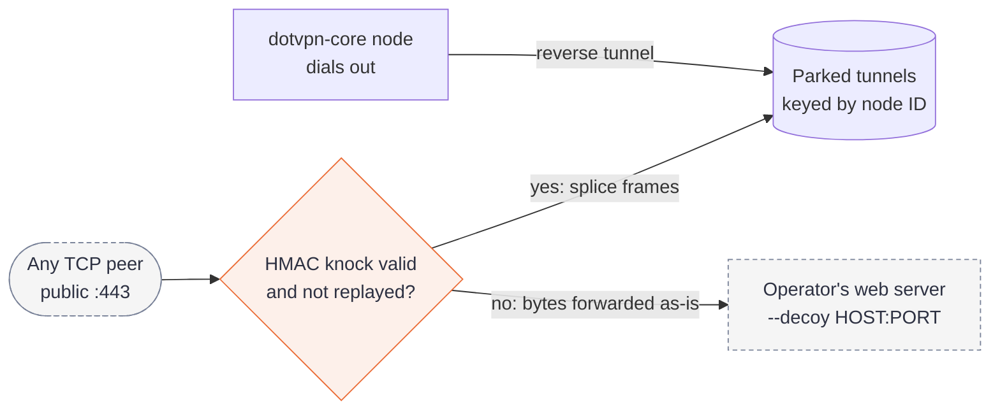

<picture>
  <source media="(prefers-color-scheme: dark)" srcset=".github/readme-header-dark.svg">
  
</picture>

# dotvpn-relay

[](https://github.com/payam-foundation/dotvpn-relay/actions/workflows/ci.yml)
[](https://github.com/payam-foundation/dotvpn-relay/releases)
[](#status)
[](LICENSE)

The in-country stealth hop of [Dot VPN](https://github.com/payam-foundation/dotvpn-wire#related-repositories). A relay looks like an ordinary HTTPS website to anyone who is not a Dot VPN client, and splices clients onto tunnels that a `dotvpn-core` node has parked on it.

A relay has **no client code, no admin code, and no user accounts**. It holds its own identity key and control's public key. Curated (admin) enrollment never stores control's URL. Community self-registration stores it only so the relay can send optional health beats; use `run -no-beat` (or the installer's `--no-beat`) to keep the seizure posture of curated installs.

## Status

Beta. Tested for code correctness and performance on a real host; resistance to a real national censor is **not** validated (see [Threat model](#threat-model)).

## How it works



- **Reverse mode.** The relay only listens. The node dials out and parks tunnels, so the node's address is in no client configuration.
- **Mimic carrier.** A Chrome-like ClientHello carries an HMAC knock. Frames are masked and padded, with X25519 forward secrecy, pool rotation and idle cover traffic.
- **Optional DNS-shaped UDP carrier** for paths that pass UDP but not TCP.
- **Decoy for everything else.** Anything that is not a valid, unreplayed knock is handed to a real TLS server and receives that server's answer. There is no silent close or reset on the probe path, and timing stays uniform.
- **Two ways onto the network.** Admins mint a one-time enroll token (curated). Anyone can `register` as a community relay; control probes the host and may quarantine or promote it. Optional signed beats report version and parked-tunnel count.
- **No access logs.** No persisted client IPs, no version banner. `/healthz` and `/metrics` bind to loopback only. Beats are opt-out with `-no-beat`.

## Quick start

`enroll` and `register` default to the production control plane at `https://ctrl.dotvpn.org` (CDN). Override with `-control` for a self-hosted or lab core. You need either that production control or your own [dotvpn-core](https://github.com/payam-foundation/dotvpn-core).

### Curated (admin token)

```sh
dotvpn-relay init   -config /etc/dotvpn-relay/config.yaml -decoy 127.0.0.1:8443
dotvpn-relay enroll -config /etc/dotvpn-relay/config.yaml -token <one-time token>
dotvpn-relay run    -config /etc/dotvpn-relay/config.yaml
```

The control URL is used once and **not** written to disk. For a self-signed control certificate, pass `-control https://…` and `-pin <base64 SHA-256 SPKI>`.

### Community (open self-registration)

```sh
dotvpn-relay init     -config /etc/dotvpn-relay/config.yaml -decoy 127.0.0.1:8443 -listen PUBLIC_IP:443
dotvpn-relay register -config /etc/dotvpn-relay/config.yaml -sni cdn.example.com -port 443
dotvpn-relay run      -config /etc/dotvpn-relay/config.yaml
```

`register` proves possession of the identity key, stores `relay_id`, control's trusted keys, and `control_url` (and `-pin` when given) for beats. Share `dotvpn-relay://<relay_id>` with clients that opt into community relays. Pass `-no-beat` to `run` if you do not want periodic contact with control.

### Docker

Distroless, non-root, read-only root filesystem, capabilities dropped, health check, 1 MB capped log:

```sh
export DOTVPN_VERSION=vX.Y.Z
docker compose -f deploy/docker/compose.yaml up -d
```

Compose comments cover `init` / `enroll` / `register` against the data volume.

### Installer (native systemd)

Prefer download → inspect → run. `deploy/install.sh` installs a release under a hardened systemd unit (dedicated user, 0640 config). SHA-256 checks the binary against `checksums.txt`; when `cosign` is on PATH (or `REQUIRE_COSIGN=1`), the installer also verifies `checksums.txt.sigstore.json`.

**Decoy geometry.** The decoy is a real TLS web server you operate (ADR-015). The relay listens on the public address (typically `PUBLIC_IP:443`); the decoy binds loopback (e.g. `127.0.0.1:8443`). They cannot share the same socket. Point DNS A/AAAA for your domain at the relay host with **DNS-only** records — a proxied CDN terminates TLS and breaks the knock. Interactive install can reuse an existing nginx/Caddy or run `--setup-decoy` to install a system Caddy/nginx for your domain (never embedded in the relay binary).

**Interactive** (TTY; curated asks for the enroll token first and loads listen/domain/DNS from control so those prompts are skipped; community shows this host’s IP then asks domain/listen; decoy always; DNS carrier under Advanced):

```sh
curl -fsSL https://raw.githubusercontent.com/payam-foundation/dotvpn-relay/main/deploy/install.sh -o install.sh
# review install.sh, then:
sudo bash install.sh
```

**Curated (non-interactive):** create the relay in core first (`dvadmin` Relays → Add), then paste the token. `GET /v1/relays/enroll/pending` fills listen/domain/DNS when omitted; decoy is still required:

```sh
curl -fsSL https://raw.githubusercontent.com/payam-foundation/dotvpn-relay/main/deploy/install.sh \
  | sudo ENROLL_TOKEN=<one-time token> bash -s -- \
    --decoy 127.0.0.1:8443
```

**Community (non-interactive):**

```sh
curl -fsSL https://raw.githubusercontent.com/payam-foundation/dotvpn-relay/main/deploy/install.sh \
  | sudo bash -s -- --register --sni relay.example.com \
    --decoy 127.0.0.1:8443 --listen <public-ip>:443
```

Both default `--control` to `https://ctrl.dotvpn.org`. A curated token must be redeemed against the **same** control that minted it: for a self-hosted core that is usually `--control https://YOUR_NODE/dotvpn/api` (interactive install asks). The enroll token travels by environment or stdin (`enroll -token -`), never argv. Curated non-interactive installs without a token fail unless `--init-only`. `--setup-decoy`, `--require-dns`, `--dns-zone`, `--upgrade`, `--rollback`, `--uninstall` (optional `--purge-firewall`), `--pin`, `--no-beat`, `--from-dir` and `--lowkey` are in `install.sh --help`. A failed enroll/register removes what the install created. The DNS carrier (`--dns-zone`) is off by default; it is a UDP/53 protocol suffix, not normal authoritative DNS hosting.

### Ports

| Mode | TCP | UDP |
|---|---|---|
| Native systemd | listen port (default 443) | 53 only with `--dns-zone` |
| Docker Compose | `443:443/tcp` | uncomment `53:53/udp` when `dns_listen`/`dns_zone` are set |
| Admin/metrics | loopback only (default `127.0.0.1:9101`) | — |

### Lowkey install

`--lowkey` installs the garble-built `neutral` release asset and derives every name from `--name` (random if omitted, printed once): binary, unit, user, `/etc/<name>`, config env var and metric. Nothing on the host, in `ps`, in `ss`, in the unit text, in journald or in the binary's strings carries the project name, and the installer checks this after install and fails if not. Add `--quiet-logs` to log only warnings. Use the same `--lowkey --name` for `--upgrade`, `--rollback` and `--uninstall`. Docker stays the `standard` form: image names, labels and history cannot be made neutral.

```sh
sudo ENROLL_TOKEN=<token> bash install.sh --lowkey --quiet-logs \
  --decoy 127.0.0.1:8443 --listen <public-ip>:443
```

This lowers fingerprinting by scanners and casual inspection. It does not make a relay undetectable (traffic shape, IP and payment links remain, see the threat model), and it does not override your host's terms: read and follow its acceptable-use policy and the law where you live. Design and residual risks: [ADR-016](docs/adr/016-lowkey-install.md).

### Production guidance

- **Use a real decoy.** Point `-decoy` at a stock nginx or Caddy with a real certificate for a plausible domain (any geography; no software geo-check). It should send no HTTP/3 `alt-svc` (the relay is TCP-only), keep its own `Server` header and error pages, and have no admin API. The built-in decoy (`-tls-cert`, `-tls-key`) exists for tests. Installer `--setup-decoy` can provision a system Caddy/nginx on loopback for your domain.
- **Domain / SNI.** Clients and nodes present your domain as SNI. DNS must point at this host without a proxied CDN in front of the relay.
- **One relay, many nodes.** Each node parks its own tunnels, keyed by node ID. Give each user cohort its own relay set, so revoking one relay does not affect the others.
- **DNS carrier.** Optional. Add `-dns-listen` and `-dns-zone` to `init` (or installer `--dns-zone`) to enable it. They go together; the installer refuses if UDP/53 is already taken.
- **Community visibility.** Self-registered relays start `public=false`; an admin promotes them with `PATCH /v1/admin/relays/{id}` (`public: true`). They must beat about every 30–45s or they leave node pools after ~90s.

Rationale and residual risks: [ADR-015](docs/adr/015-relay-operational-exposure.md).

## Threat model

| Resists | Does not resist |
|---|---|
| Active probing: non-TLS bytes, wrong or missing SNI, partial hellos, bad or replayed knocks all get the decoy's answer. | Traffic-shape analysis: tunnelled traffic keeps its packet-size and timing profile; padding covers the handshake only. |
| Relay seizure (curated): the host holds only its own identity and control's public key. Revoke it at control and enrol a new one. | Community register also stores `control_url` (and optional TLS pin) for beats unless you run with `-no-beat` and clear those fields. |
| Replay: the knock cache and token expiry refuse replays; sessions have forward secrecy. | Hosting-provider netflow, payment identity and host connection tracking, which link a relay to its operator. |
| Fingerprinting: the ClientHello matches current Chrome and replies match stock nginx on the tested host. | A censor that blocks the relay's address outright. Anything not yet captured from a real censored network. |

The [lab](https://github.com/payam-foundation/dotvpn-lab#what-a-green-result-means) checks mechanisms against documented censor behaviour. It does not prove the relay works in any given country.

If a relay is seized or suspected compromised, revoke it at control (`DELETE /v1/admin/relays/{id}`) and replace it with a new identity. Nothing on a curated host reaches core; a community host may still name control in `control_url`.

Design decisions: [enrollment](docs/adr/012-relay-enrollment.md), [reverse-first](docs/adr/013-reverse-first-relay.md), [probe resistance](docs/adr/014-probe-resistance.md), [operational exposure](docs/adr/015-relay-operational-exposure.md), [lowkey install](docs/adr/016-lowkey-install.md).

## Verify a release

```sh
cosign verify-blob --bundle checksums.txt.sigstore.json \
  --certificate-identity-regexp 'https://github.com/payam-foundation/dotvpn-relay/' \
  --certificate-oidc-issuer https://token.actions.githubusercontent.com checksums.txt
sha256sum -c --ignore-missing checksums.txt
```

## Upgrade and rollback

The config format is additive. Identity and enrollment survive a rollback.

| Install | Rollback |
|---|---|
| Installer | `install.sh --upgrade` keeps the previous binary as `<name>.prev`; `install.sh --rollback` restores it. |
| Binary | Keep the previous release as `dotvpn-relay.prev` before replacing, then `mv dotvpn-relay.prev dotvpn-relay && systemctl restart dotvpn-relay`. |
| Docker | Set `DOTVPN_VERSION` to the previous tag and run `docker compose up -d`. |

If control rotated its key, run `enroll` or `register` again. A wire major bump is a flag day for core, relay and client: roll all components together.

## Development

Requires the Go version in `go.mod`.

```sh
go build ./... && go vet ./...
go test -race -count=1 ./...
shellcheck deploy/install.sh deploy/garble-build.sh
```

The installer is tested end to end on a real systemd in `dotvpn-lab` (`suites/deploy`, `TestLowkeyInstall`).

`go.mod` pins an exact `dotvpn-wire` tag. For side-by-side work with a sibling checkout use an untracked `go.work` in the parent directory (see CONTRIBUTING.md). CI tests against the pinned wire tag and wire `main`. The relay never imports core or client; anything shared lives in `dotvpn-wire`.

Read [CONTRIBUTING.md](CONTRIBUTING.md) first. Report vulnerabilities as described in [SECURITY.md](SECURITY.md).

## Related repositories

| Repository | Role |
|---|---|
| [dotvpn-wire](https://github.com/payam-foundation/dotvpn-wire) | Shared wire protocol |
| [dotvpn-core](https://github.com/payam-foundation/dotvpn-core) | Server: node, control plane |
| [dotvpn-client](https://github.com/payam-foundation/dotvpn-client) | Client library and `dotvpn` CLI |
| [dotvpn-android](https://github.com/payam-foundation/dotvpn-android) | Android app |
| [dotvpn-lab](https://github.com/payam-foundation/dotvpn-lab) | Censorship lab, architecture and ADR index |

## License

[PolyForm Noncommercial License 1.0.0](LICENSE). Source-available, not open source: personal, research, educational and non-profit use is permitted; commercial use needs a separate licence from Payam Foundation.
